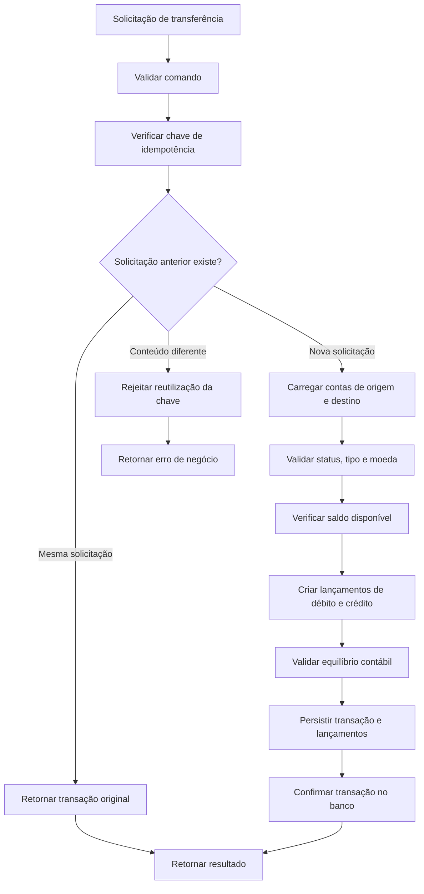
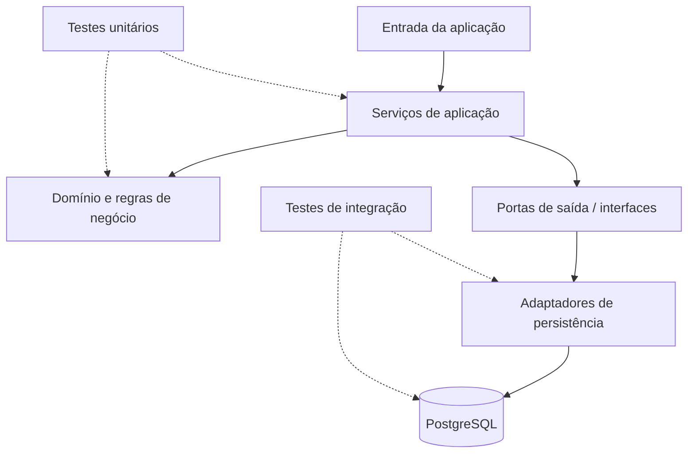

# PayFlow

**PayFlow** é um projeto educacional de processamento financeiro desenvolvido com Java, Spring Boot e PostgreSQL. Seu objetivo é explorar como fluxos de pagamento podem ser modelados e implementados utilizando práticas de engenharia de software aplicadas a sistemas backend.

Mais do que fazer funcionalidades funcionarem, o projeto busca compreender **como as regras de negócio são organizadas, como as operações financeiras são protegidas e como garantir a consistência dos dados**.

> **Projeto educacional:** o PayFlow é um ambiente de aprendizado e não está preparado para processar dinheiro real.

## Objetivos de aprendizado

O projeto explora os seguintes conceitos:

- **Java moderno:** records, enums, objetos de valor, imutabilidade e tratamento de exceções.
- **Spring Boot:** injeção de dependências, configuração da aplicação e gerenciamento de transações.
- **Domain-Driven Design (DDD):** modelagem de conceitos financeiros e proteção das regras de negócio.
- **Arquitetura Hexagonal:** separação entre regras de negócio, banco de dados e frameworks.
- **Processamento de pagamentos:** transferências, consulta de saldos e idempotência.
- **Contabilidade de partidas dobradas:** registro de movimentações por meio de débitos e créditos balanceados.
- **Integridade de dados:** transações, restrições do PostgreSQL e migrações com Flyway.
- **Testes automatizados:** testes unitários e de integração.
- **Práticas de engenharia:** configuração por ambiente, observabilidade, cobertura de testes e integração contínua.
- **Build reproduzível:** gerenciamento de dependências e execução de tarefas com Gradle.

## Funcionalidades e conceitos

O projeto contém implementações e testes relacionados às seguintes funcionalidades:

- Abertura e validação de contas.
- Contas de clientes e contas de compensação (*clearing accounts*).
- Consulta de saldo das contas.
- Disponibilização de fundos em ambiente sandbox.
- Transferências entre contas de clientes.
- Transações contábeis compostas por lançamentos de débito e crédito.
- Validações de transações e restrições de integridade no banco de dados.
- Idempotência para solicitações repetidas de transferência.
- Persistência com PostgreSQL e migrações gerenciadas pelo Flyway.
- Testes unitários e de integração automatizados.

As moedas atualmente contempladas pelo domínio são **BRL** e **USD**. Consulte as implementações e as migrações do banco para conhecer as regras específicas de cada operação.

## Entendendo o fluxo de uma transferência

Uma transferência não consiste apenas em subtrair um valor de uma conta e adicioná-lo a outra. É necessário validar a solicitação, evitar duplicidades e registrar a movimentação contábil de forma consistente.

O diagrama abaixo representa o fluxo conceitual de uma transferência no PayFlow:



O diagrama é uma visão conceitual. Para compreender a ordem exata de execução, consulte o serviço de transferência, os serviços de aplicação relacionados e os repositórios.

### Por que utilizar um ledger?

Um *ledger* é um registro contábil das movimentações financeiras. Ele permite entender de onde veio cada movimentação, para onde foi o valor e qual transação originou os lançamentos.

Considere uma transferência de R$ 50,00 entre duas contas na mesma moeda:

| Conta | Tipo de lançamento | Valor |
|---|---|---:|
| Conta de origem | Débito | R$ 50,00 |
| Conta de destino | Crédito | R$ 50,00 |

Os lançamentos estão balanceados porque o total de débitos é igual ao total de créditos para essa moeda.

No PayFlow:

- Cada lançamento representa um débito ou crédito.
- Os valores são representados em unidades monetárias menores, evitando cálculos com ponto flutuante.
- Uma transação contábil precisa respeitar as regras de balanceamento.
- Os lançamentos são persistidos respeitando as fronteiras transacionais apropriadas.
- O saldo é calculado a partir dos lançamentos contábeis, em vez de ser tratado como o único registro da movimentação financeira.

A aplicação valida as regras de negócio, enquanto o banco de dados reforça a integridade por meio de transações e restrições.

## Arquitetura

O PayFlow busca seguir os princípios da **Arquitetura Hexagonal**, também conhecida como *Ports and Adapters* (portas e adaptadores).

O objetivo é manter as regras de negócio independentes, tanto quanto possível, dos detalhes de implementação e das tecnologias utilizadas.



### Responsabilidades das camadas

**Domínio**

Representa os conceitos financeiros, os objetos de valor e as regras que precisam permanecer válidas. Exemplos incluem contas, dinheiro e transações contábeis.

**Aplicação**

Coordena os casos de uso e organiza as interações entre o domínio e as portas de saída.

**Portas**

Definem os contratos que a aplicação utiliza para acessar recursos externos, como repositórios.

**Adaptadores**

Implementam esses contratos utilizando tecnologias concretas, como JDBC e PostgreSQL.

**Banco de dados**

Armazena os registros financeiros e reforça regras importantes por meio de transações, restrições e migrações.

Essa separação permite testar muitas regras de negócio sem precisar iniciar toda a aplicação ou conectar-se ao banco de dados em cada teste.

## Tecnologias utilizadas

| Tecnologia | Finalidade |
|---|---|
| Java 21 | Linguagem de programação |
| Spring Boot | Injeção de dependências e infraestrutura da aplicação |
| Gradle Kotlin DSL | Configuração do build e gerenciamento de dependências |
| Gradle Wrapper | Execução reproduzível do build e dos testes |
| PostgreSQL 18 | Persistência relacional |
| Flyway | Versionamento e execução de migrações do banco |
| JDBC | Acesso ao banco pelos adaptadores de persistência |
| JUnit | Testes automatizados |
| Mockito | Simulação de dependências e verificação de interações nos testes |
| JaCoCo | Relatórios de cobertura de testes |
| Spring Boot Actuator | Verificações de saúde e métricas |
| Docker Compose | Ambiente local para o PostgreSQL |
| ASM | Transformação de bytecode Java para validações de records |

## Como executar localmente

### Pré-requisitos

Instale as seguintes ferramentas:

- JDK 21.
- Docker com Docker Compose.
- Git.

O Gradle Wrapper incluído no repositório gerencia a versão do Gradle utilizada pelo projeto. Não é necessário instalar o Gradle globalmente.

### 1. Clone o repositório

```bash
git clone https://github.com/ffakira/payflow.git
cd payflow
```

### 2. Configure a senha do banco de dados

A aplicação utiliza a variável de ambiente `DB_PASSWORD` para obter a senha do PostgreSQL.

**Linux/macOS:**

```bash
export DB_PASSWORD='sua-senha-local'
```

**Windows PowerShell:**

```powershell
$env:DB_PASSWORD = "sua-senha-local"
```

Utilize uma senha apropriada para o ambiente local. Não armazene credenciais ou segredos de produção no repositório.

### 3. Inicie o PostgreSQL

Na raiz do projeto, execute:

```bash
docker compose up -d
```

O Docker Compose disponibiliza o PostgreSQL na porta `5433` do endereço `localhost`.

Para verificar o estado do contêiner:

```bash
docker compose ps
```

As migrações do Flyway são executadas pela aplicação durante a inicialização, conforme sua configuração.

### 4. Execute os testes

**Linux/macOS:**

```bash
./gradlew clean check
```

**Windows:**

```powershell
.\gradlew.bat clean check
```

O ciclo `check` executa as verificações configuradas no Gradle, incluindo os testes automatizados. O relatório de cobertura do JaCoCo é gerado pela tarefa de relatório configurada no build.

Para executar apenas os testes:

```bash
./gradlew test
```

Para gerar o relatório de cobertura explicitamente:

```bash
./gradlew jacocoTestReport
```

Após a execução, consulte os relatórios em:

- **Cobertura HTML:** `build/reports/jacoco/test/html/index.html`
- **Cobertura XML:** `build/reports/jacoco/test/jacocoTestReport.xml`
- **Resultados dos testes:** `build/reports/tests/test/index.html`

Os caminhos correspondem à configuração padrão de saída do JaCoCo e do Gradle, salvo alterações no build.

### 5. Inicie a aplicação

**Linux/macOS:**

```bash
./gradlew bootRun
```

**Windows:**

```powershell
.\gradlew.bat bootRun
```

Durante a inicialização, o Flyway gerencia as migrações do banco de dados.

### 6. Encerre o PostgreSQL

```bash
docker compose down
```

Esse comando encerra o contêiner, mas preserva o volume de dados.

Para remover também os dados locais:

```bash
docker compose down -v
```

**Atenção:** a opção `-v` remove o volume do banco de dados e apaga os dados locais armazenados nele.

## Roteiro de estudo do código

Uma boa maneira de aprender é acompanhar um caso de uso por vez, desde as regras de negócio até a persistência.

### 1. Estude o domínio

Comece pelas contas, identificadores, moedas e objetos de valor relacionados a dinheiro.

Procure responder:

- Por que representar valores monetários com unidades menores inteiras em vez de utilizar números de ponto flutuante?
- Por que os tipos e estados das contas são explícitos?
- Quais validações pertencem ao domínio e quais pertencem aos serviços de aplicação?

### 2. Acompanhe a abertura de uma conta

Siga o comando até o serviço de aplicação, observe as validações e acompanhe a chamada ao repositório.

Identifique como a injeção de dependências funciona e como os testes verificam tanto os resultados esperados quanto as falhas.

### 3. Entenda o ledger

Leia os modelos de transação contábil e de lançamento. Depois, examine as migrações do banco de dados.

Observe como a aplicação e o PostgreSQL protegem o balanceamento contábil e a integridade dos registros.

### 4. Siga o fluxo de transferência

Acompanhe o serviço de transferência e identifique as etapas de validação das contas, consulta de saldo, idempotência e registro contábil.

Tente responder:

- O que acontece quando a conta de origem não possui saldo suficiente?
- O que ocorre quando uma solicitação é repetida com a mesma chave de idempotência?
- Como o sistema reage quando a mesma chave é utilizada com parâmetros diferentes?
- Como as gravações parciais são evitadas?

### 5. Estude as transações do banco

Localize os métodos que utilizam o gerenciamento transacional do Spring e acompanhe as chamadas aos repositórios.

Operações relacionadas precisam ser confirmadas ou revertidas em conjunto. Também vale investigar como bloqueios de contas e solicitações concorrentes afetam a consistência financeira.

### 6. Compare testes unitários e de integração

Os testes unitários ajudam a isolar regras de negócio e comportamentos dos serviços. Os testes de integração verificam a interação com a infraestrutura real, incluindo as restrições e o comportamento transacional do PostgreSQL.

Os dois tipos são importantes: um teste unitário aprovado não comprova, por si só, que uma restrição do banco está funcionando corretamente.

### 7. Explore o build e a transformação de bytecode

O projeto utiliza Gradle Kotlin DSL para configurar dependências, tarefas de compilação, testes e relatórios.

Também é possível estudar a transformação de bytecode implementada com ASM para compreender como classes Java compiladas podem ser modificadas programaticamente.

Investigue:

- Como as dependências de compilação e teste são declaradas.
- Como o Gradle organiza as tarefas de compilação, transformação e teste.
- Como a transformação de bytecode interage com os construtores dos records.
- Como os testes verificam o comportamento após a transformação.

## Princípios de engenharia

À medida que o projeto evolui, estes princípios ajudam a orientar as decisões técnicas:

- **Correção antes da conveniência:** as regras financeiras devem ser explícitas e testáveis.
- **Histórico contábil confiável:** os lançamentos devem explicar as movimentações financeiras.
- **Atomicidade:** operações relacionadas não devem deixar transações parcialmente persistidas.
- **Idempotência:** novas tentativas não devem executar acidentalmente a mesma operação financeira mais de uma vez.
- **Erros explícitos:** falhas de negócio esperadas devem utilizar códigos estáveis.
- **Separação de responsabilidades:** as regras de domínio não devem depender desnecessariamente do Spring ou de detalhes do banco.
- **Testes orientados ao comportamento:** os testes devem demonstrar resultados e regras importantes, não apenas a execução de métodos.
- **Build reproduzível:** o Gradle Wrapper e as dependências declaradas devem permitir que outros desenvolvedores executem o projeto de maneira consistente.
- **Complexidade gradual:** novas abstrações devem resolver problemas reais, em vez de serem introduzidas apenas para imitar sistemas maiores.

## Próximas etapas de aprendizado

Algumas evoluções possíveis para o projeto:

- Padronizar exceções de negócio e códigos de erro.
- Criar respostas HTTP consistentes para falhas da aplicação.
- Expandir os testes de concorrência e idempotência.
- Documentar contratos da API e exemplos de requisições e respostas.
- Melhorar logs, métricas e diagnóstico operacional.
- Explorar estornos, tarifas, saques e conversão cambial.
- Aprofundar os estudos de segurança, autenticação, autorização e auditoria.
- Avaliar os resultados de cobertura e identificar lacunas relevantes nos testes.

Esses itens representam possibilidades de evolução, e não necessariamente funcionalidades já implementadas.

## Aviso

O PayFlow é um projeto educacional para estudar processamento de pagamentos e práticas de engenharia de software com Java.

Ele não foi validado como um sistema financeiro pronto para produção. O processamento de dinheiro real exigiria, entre outros aspectos, controles de segurança, autenticação e autorização, monitoramento operacional, auditoria, mecanismos de recuperação de falhas, análise de concorrência, testes de carga, avaliação de conformidade e revisão independente de segurança.
